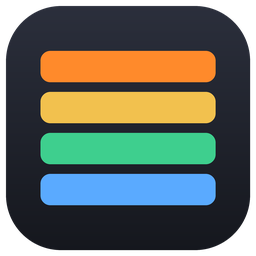
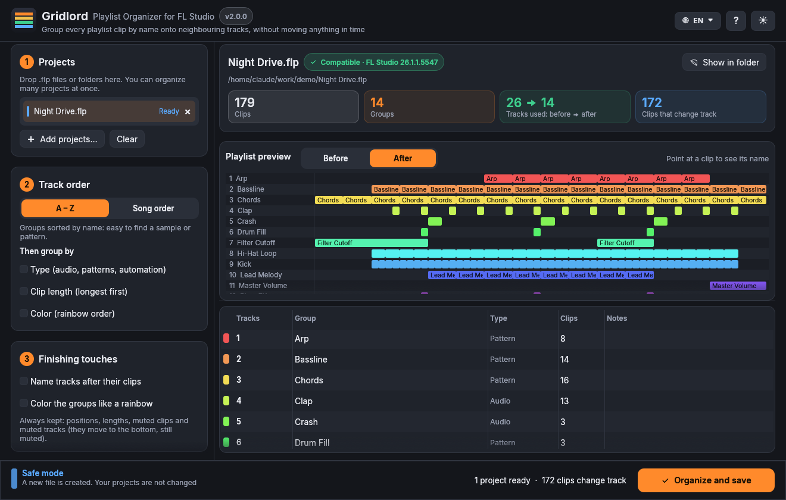

<p align="center">
  
</p>

<h1 align="center">Gridlord</h1>
<p align="center"><b>Playlist Organizer for FL Studio</b><br>
Group every clip in your FL Studio playlist by name onto neighbouring tracks, in one click, without moving a single note in time.</p>

<p align="center">
  <a href="../../releases/latest/download/Gridlord-windows.exe"></a>
  &nbsp;
  <a href="../../releases/latest/download/Gridlord-macos.dmg"></a>
</p>
<p align="center"><sub>Free · Open source · Windows 10/11 and macOS 11+ (Apple Silicon &amp; Intel) · FL Studio 2025 and newer · <a href="../../releases">All versions</a></sub></p>

<p align="center">
  
</p>

---

## The problem

You start a beat, drag a kick here, a snare there, duplicate a pattern a few times, try an idea on track 37…
Two hours later the playlist is chaos: the same sample is scattered over ten tracks, patterns are mixed with
automation clips, and finding anything takes forever.

FL Studio has no button for "put every *Kick* on the same track, every *Snare* on the next one".
*Select source channel* plus *Shift+drag* moves clips in parallel, but it never collapses them onto one lane.

## The fix

Gridlord opens your `.flp`, groups every clip by its name (sample, channel, pattern or automation) and puts each
group on its own neighbouring tracks. Positions, lengths, colors, automation data, plugins and mixer stay exactly
as they were: only the track of each clip changes.

## Features

- **One click, whole playlist:** every audio clip, pattern and automation clip is grouped by name
- **Two orders:** **A–Z** (find any sample instantly) or **Song order** (the playlist reads top to bottom like your track)
- **Fine sorting:** then group by type (audio, patterns, automation), clip length or color (rainbow order)
- **Smart lanes:** clips of the same group that overlap in time go on adjacent tracks, never on top of each other
- **Muted tracks stay muted:** their clips move to the bottom on tracks that stay muted; muted clips stay muted
- **Finishing touches (optional):** name each track after its clips, color the groups like a rainbow
  (colors you picked yourself are kept)
- **Live preview:** see the playlist before and after, hover a clip to see its name and group
- **Batch mode:** drop a whole folder of projects and organize them all at once
- **Safe by design:**
  - by default it saves a **new file** (`Project_organized.flp`): your project is never touched
  - or replace the original, with an automatic **backup copy** next to it
  - every result is **read back and checked** before it is saved: if anything does not match, nothing is written
  - if the project changed on disk after loading (saved again in FL Studio), Gridlord notices and reloads it
  - a compatibility check runs on every project before anything happens
- **Fast:** written in Rust, a 50 MB project is ready in a blink
- **7 languages:** English, 中文 (Chinese), Deutsch, Español, Français, Italiano, Русский (switch from the 🌐 menu)
- **Clean interface:** dark & light themes, drag & drop, resizable panels
- **Welcome guide:** a short illustrated tour on first launch (reopen it anytime with the **?** button)
- **Portable:** a single file, no installation, no internet connection, no account

## Download

| System | Download |
|---|---|
| Windows 10 / 11 | **[Gridlord-windows.exe](../../releases/latest/download/Gridlord-windows.exe)** (or **[.zip](../../releases/latest/download/Gridlord-windows.zip)** if your browser blocks the .exe) |
| macOS 11+ (Apple Silicon & Intel) | **[Gridlord-macos.dmg](../../releases/latest/download/Gridlord-macos.dmg)** (or **[.zip](../../releases/latest/download/Gridlord-macos.zip)**) |

Older versions and release notes: **[Releases](../../releases)**.

> **Windows:** the first time, SmartScreen may say "Windows protected your PC".
> Click **More info → Run anyway**. The app is not code-signed (signing certificates are expensive),
> but the full source code is right here.
>
> **macOS:** open the `.dmg` and drag **Gridlord** onto the **Applications** folder, then **right-click → Open** it the first time.
> On macOS 15+ you may need **System Settings → Privacy & Security → Open Anyway**.

## How to use it

1. **Save your project in FL Studio.**
2. Open Gridlord and drop your `.flp` onto the window (or click **Add projects…**). Folders work too.
3. Choose the order (**A–Z** or **Song order**) and, if you like, the finishing touches.
4. Check the **preview**: switch between *Before* and *After*.
5. Click **Organize and save**. By default you get `YourProject_organized.flp` next to the original.
6. Open the new file in FL Studio, hit play: it sounds identical, it just looks tidy.

### Tips

- **Name your channels and patterns before organizing.** Clips are grouped by name, so a channel called
  *Kick Top* groups better than *Sampler #37*.
- **Clips that share a name end up together.** If you want two automations on separate tracks, give them different names.
- **Replacing the original?** Close the project in FL Studio first, otherwise FL Studio would save over the organized version.

## Compatibility

| FL Studio | Status |
|---|---|
| FL Studio 2026 (26.x) | ✅ Tested on real projects |
| FL Studio 2025 (25.x) | ✅ Supported (same playlist format tested in FLP Organizer) |
| FL Studio 2024 (24.x) | ✅ Supported (same playlist format tested in FLP Organizer) |
| FL Studio 20.7 – 21.x | Should work: the compatibility check tells you if something looks unusual |
| Older than 20.7 | Not supported (no arrangements in the file format) |

Projects saved by a version that has not been tested yet are still opened: Gridlord shows a note and you
can check the result in FL Studio before keeping it.

## How it works

An `.flp` file is a list of *events*. Each arrangement contains a playlist event: an array of fixed-size records,
one per clip, with its position, length, source (channel or pattern) and track. Gridlord reads the project,
groups the clips, assigns lanes inside each group and then **changes only the two bytes that store the track of
each clip** (plus, if you ask for them, track names, track mute flags and group colors).
Everything else in the file stays byte-for-byte identical.

The record size differs between versions (80 bytes in FL Studio 24/25, 88 bytes in FL Studio 2026) and is
detected automatically. FL Studio 2026 also writes one event with a non-standard size, which Gridlord handles.

## Build from source

Requires [Rust](https://rustup.rs) (stable).

```bash
git clone https://github.com/mattdanieli/Gridlord.git
cd Gridlord
cargo run --release
cargo test
```

Every push to `main` builds Windows and macOS versions with GitHub Actions; a new version number in
`Cargo.toml` creates a new release automatically.

## Disclaimer

Gridlord is an independent, free tool. It is **not affiliated with or endorsed by Image-Line**.
FL Studio is a trademark of Image-Line Software. Always keep a backup of the projects you care about.

## License

[MIT](LICENSE)
